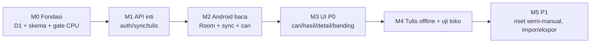

# PLAN: Implementasi "Cocok" (Cloudflare)

Rencana kerja teknis, turunan dari `PRD.md`, `DESIGN.md`, dan `ARCHITECTURE.md` (versi Cloudflare).
Urutan fase mengikuti ketergantungan nyata: **data & aturan dulu, API kedua, aplikasi ketiga**.



**Aturan kerja:** setiap milestone selesai hanya jika kriteria penerimaannya terbukti dijalankan (bukan "sudah ditulis").

## Status implementasi — 18 November 2026

- Urutan pengerjaan diubah atas permintaan pemilik: frontend Android terlebih dahulu, lalu penyimpanan lokal.
- **Selesai:** Room (`cocok.db`) menyimpan mobil, kategori, barang, kelompok, isi kelompok, kecocokan, sinonim, dan konfirmasi. Data contoh hanya dimasukkan pada inisialisasi pertama. Skema versi 1 diekspor ke `android/app/schemas/`.
- Penambahan barang + kelompok + tautannya dilakukan dalam satu transaksi; hanya baris yang berubah ditulis. Pesan berhasil dan penutupan formulir menunggu commit. Kegagalan mempertahankan data lama dan isian formulir.
- Penolakan foreign key diperiksa sebelum commit agar rollback tidak meninggalkan koneksi SQLite Android dalam transaksi yang gagal.
- **Bukti:** APK debug berhasil dibangun; 19 uji JVM lulus; 4 uji Room di Infinix API 36 lulus (buka ulang, rollback, penulisan bersamaan, seed kosong). Barang dan nomor part yang ditambahkan lewat layar tetap dapat dicari setelah proses aplikasi dihentikan dan dibuka kembali.
- **Cloudflare sebagian dibuat:** akun kedua `baniputrabangsawan11@gmail.com` (`519a19168b85622ae3389900cc145d89`) memiliki D1 dan Worker terpisah untuk produksi/uji. Migrasi `api/migrations/0001_init.sql` sudah diterapkan ke kedua database: skema versi 1, 27 trigger `sync_log`, katalog produksi kosong tanpa data demonstrasi.
- **R2 terblokir aktivasi pembayaran:** API mengembalikan `403`, kode `10042` (“Please enable R2 through the Cloudflare Dashboard”). Pengguna sudah menyetujui ketentuan dan tagihan sesuai pemakaian, tetapi checkout meminta kartu/alamat tagihan yang belum tersedia. Bucket dan binding R2 remote **belum dibuat**. Konfigurasi `api/wrangler.jsonc` mencantumkan target bucket; deployment Wrangler lengkap menunggu aktivasi dan pembuatan bucket tersebut.
- **Worker sudah dideploy dengan binding D1 saja.** `/v1/health` remote sengaja belum dianggap siap: terverifikasi `503 storage_unavailable` karena R2 belum tersedia. Dengan D1 dan R2 lokal, rute yang sama terverifikasi `200` dengan `{ ok: true, schema: 1, environment: "staging" }`. Rute data/foto belum tersedia (`404`), sehingga katalog tidak terbuka ke publik.
- **Bukti fondasi API:** typecheck TypeScript dan build Wrangler lulus; migrasi lokal lulus; kedua migrasi remote masing-masing 69 statement berhasil. Smoke skema membuktikan kursor monoton, ID komposit tanpa benturan, soft delete masuk log, dan rollback foreign key. Lokasi kode: `api/`; dependensi dipatok dan `package-lock.json` disimpan.
- **Belum tersedia:** autentikasi pengguna, sinkronisasi antar-HP, serta outbox pengiriman ke server. Pemilihan peran dan sambungan Android masih simulasi tampilan, bukan kontrol akses produksi. Android belum dihubungkan ke Worker.
- Sesi demo dan riwayat pencarian masih hanya di memori; katalog tidak ikut dihapus saat keluar dari sesi.

### Pencarian gambar berdasarkan keyword — pembaruan

- Mengikuti pola yang diamati pada APK ImageSearchMan: keyword dikirim ke Google Images (`q`, `udm=2`), respons diparse menjadi judul, thumbnail, URL gambar asli, dan URL sumber. Hasil tampil sebagai **grid kartu Compose native**, bukan halaman Google/Lens.
- `GoogleKeywordSearch` memakai WebView sementara tanpa tampilan untuk memuat respons Google yang memerlukan JavaScript. Tidak ada jembatan ke Room, pemilihan berkas, atau unggahan foto. Parser hanya membaca literal data; WebView dihancurkan setelah selesai, gagal, atau dibatalkan.
- Kamera/galeri tetap tersedia untuk OCR lokal dan pratinjau. Keyword bisa diketik tanpa foto atau diperbaiki setelah OCR; berkas foto tidak dikirim ke pencarian internet. Jalur Lens dan persetujuan unggah lama dihapus.
- Kartu membuka URL sumber HTTPS asli; tombol “Cari di Shopee” membuka pencarian keyword, bukan tautan produk yang dibuat-buat. Gambar internet tidak diberi label kecocokan.
- Tab **Data toko** tetap menggunakan pencarian/nomor part dan konteks mobil/tahun yang ada; koreksi OCR hanya pada jalur foto. Hasil internet tidak menulis atau menaikkan status katalog.
- **Bukti:** build APK debug lulus; 6 uji parser menggunakan rekaman respons nyata dan 2 uji URL lulus. Emulator API 35 menampilkan **96 gambar** untuk `81560-0K290`, termasuk thumbnail lampu dan sumber eBay; kartu membuka Chrome, Data toko menemukan nomor part lokal, dan detail/kembali mempertahankan pencarian. Screenshot: `android/captures/keyword-native-results.png`, `keyword-native-cards.png`, `keyword-store-check.png`.
- **Batas layanan:** ini parser respons web, bukan API resmi Google dengan kontrak stabil. Format, CAPTCHA, persetujuan, dan pembatasan Google dapat menghentikan pencarian; aplikasi menampilkan kesalahan, tidak melewati pemeriksaan atau menyajikan data palsu. Tidak ada API berbayar atau R2 untuk pencarian ini.
- **Batas uji:** pengujian fisik Infinix terputus karena perangkat berpindah ke AndroBD; uji grid dilakukan di emulator terpisah. Kamera/cancel, OCR foto baru, rotasi/process recreation, serta CAPTCHA nyata belum diuji ulang pada versi native ini. Tautan sumber berhasil meluncurkan Chrome tetapi berhenti pada onboarding browser; halaman penjual belum diverifikasi. Foto lokal masih cache sementara. Rincian gate visual yang belum lengkap dicatat di `android/captures/keyword-evidence.json`.

### Pencocokan barang (fitur utama) — pembaruan

- Alur utama sekarang **satu sumber -> kandidat -> perbandingan**, bukan sekadar cari gambar. Sumber bisa dari foto, kata kunci, atau barang yang sudah ada di data toko.
- `MatchParts` (domain murni) memisahkan tiga hal: **penemuan** (`discover`), **perbandingan** (`compare`), dan **bukti pemilik** (`record`). Penemuan tidak pernah memberi label cocok.
- Perbandingan menampilkan dua identitas berdampingan, baris spesifikasi `sama / beda / belum ada`, dan daftar **pemeriksaan fisik** untuk data yang kosong. Spesifikasi yang sama **tidak** menaikkan hasil menjadi "pengganti"; nilainya tetap `Kandidat — belum terverifikasi`.
- Label `Pengganti terverifikasi` / `Barang sama` hanya berasal dari `MatchEvidence` pemilik yang terikat ke mobil + tahun + varian. Peran kasir ditolak, konteks tidak lengkap ditolak, dan bukti tidak bocor ke mobil lain.
- Foto polos memakai **embedding lokal nyata** (`LocalVisualMatcher`, MediaPipe ImageEmbedder + MobileNet-v3-small, Apache-2.0, `android/app/src/main/assets/mobilenet_v3_small.tflite`). Skor kosinus adalah kemiripan bentuk, bukan peluang cocok. Tanpa foto di katalog, aplikasi menyatakan belum ada indeks foto—bukan mengarang hasil.
- Kemiripan internet memakai unggahan foto setelah **persetujuan eksplisit** per foto (`GoogleVisualSearch`), dibatasi HTTPS + JPEG tanpa metadata + batas ukuran; tidak ada CAPTCHA/persetujuan yang dilewati, tidak ada halaman hasil di dalam aplikasi.
- Room naik ke **versi 2** (`specifications` pada `parts`, tabel `match_evidence`) dengan migrasi eksplisit 1 -> 2; data lama tidak di-seed ulang dan `PRAGMA foreign_key_check` sebelum commit tetap dipertahankan.
- Penyimpanan item baru dari hasil pencarian selalu membuat grup `MUNGKIN` sendiri; tidak menyimpulkan ekuivalensi dari foto atau judul internet.

### Resource Cloudflare yang sudah dibuat

| Lingkungan | D1 | Database ID | Worker |
|---|---|---|---|
| Produksi | `cocok-db` | `be04939d-aed1-4795-b8a4-d44c974bfde1` | `https://cocok-api.baniputrabangsawan11.workers.dev` |
| Uji | `cocok-db-staging` | `96782bd6-8b5c-41a6-a340-10eb81b8ee26` | `https://cocok-api-staging.baniputrabangsawan11.workers.dev` |

Penyelesaian yang masih terblokir: selesaikan checkout R2 langsung di dasbor akun kedua, buat `cocok-photos` dan `cocok-photos-staging` (Standard, privat), pasang binding `PHOTOS` pada masing-masing Worker, lalu jalankan smoke `/v1/health` sampai `200` di kedua lingkungan. Jangan mengisi produksi dengan nomor part contoh yang belum diverifikasi.

Perintah lokal dari `api/`: `npm ci`, `npm run migrate:local`, `npm run dev`. Migrasi/deploy remote lewat Wrangler memerlukan login CLI terpisah pada akun kedua; token OAuth MCP bukan token API untuk Wrangler. `.omp/mcp.json` kini meminta hanya izin akun dasar, D1 Write, Workers R2 Storage Write, dan Workers Scripts Write. Jalankan `/mcp reload` agar sesi OMP memakai konfigurasi izin yang baru.


---

## Koreksi teknis terhadap ARCHITECTURE.md

Dicek terhadap dokumen resmi Cloudflare (batas paket, D1, R2) dan rilis AndroidX per 17 Nov 2026. Angka batas diambil dari halaman resmi; angka CPU login berasal dari laporan pihak ketiga dan **wajib diukur sendiri** (K3).

| # | Dokumen sekarang | Masalah | Keputusan |
|---|---|---|---|
| K1 | `GET /sync?since=<updated_at>` + klien hapus duplikat | Perbandingan timestamp: perubahan dengan waktu sama bisa terlewat, jam klien/server bisa selisih; satu request harus menyentuh 8 tabel ber-index = banyak baris dibaca | Tambah tabel `sync_log(seq INTEGER PRIMARY KEY AUTOINCREMENT, table_name, record_id, action, changed_at)` + trigger per tabel. Klien menyimpan `seq` terakhir. Satu kursor, tidak ada data hilang, hemat `rows_read` D1 |
| K2 | Tidak disebut | Workers Free: **50 query per invocation**; `db.batch()` dihitung 1 | Semua rute sync/tulis memakai `db.batch()`; halaman sync maks 500 baris; perhatikan batas 100 parameter terikat dan 100 KB per statement |
| K3 | "Login mungkin kena batas CPU, perlu diuji" | Laporan pihak ketiga (Okt 2026): PBKDF2-SHA256 100.000 iterasi ≈ **19–23 ms CPU**, sedangkan Workers Free = **10 ms/request**; WebCrypto menolak iterasi > 100.000. Cloudflare menoleransi sedikit pelanggaran, tapi tidak dijanjikan. Angka ini **wajib diukur ulang sendiri** | **Gerbang M0**: ukur 20 login lewat `wrangler tail`. Aman → lanjut. Tidak aman → Workers Paid $5/bln (rekomendasi) atau turunkan iterasi (tidak disarankan: melemahkan hash). Keputusan ditulis sebelum auth dibuat |
| K4 | "Room (SQLite) + FTS" | FTS menambah kompleksitas nyata: `@Fts5` hanya ada di Room 3.0, `@Fts4` memakai tokenizer yang tidak mengenal sinonim/imbuhan Indonesia, dan SQLite bawaan berbeda antar-HP. Padahal data hanya puluhan ribu baris teks | **Jangan pakai FTS dulu.** Pencarian = normalisasi + sinonim di Kotlin, lalu query berindeks (`parts.name`, `vehicles.model`, `part_number` exact/prefix), hasil dipersempit di SQL sebelum diranking trigram di Kotlin. FTS5 baru dipertimbangkan bila terukur p95 > 200 ms atau tabel part > 20 ribu baris |
| K5 | "EncryptedSharedPreferences / DataStore + Tink" | `androidx.security:security-crypto` sudah **deprecated** (1.1.0), tanpa rilis lanjutan | Pilih satu: **DataStore + Tink AEAD**, master key di Android Keystore. Hapus opsi EncryptedSharedPreferences |
| K6 | `GET /photos/:key` | `r2.dev` hanya untuk pengembangan (rate-limited, tanpa cache/WAF) | Foto dilayani lewat Worker + Cache API (foto milik toko, tidak publik). `r2.dev` tidak dipakai di produksi |
| K7 | "D1 5 GB data" | 5 GB = total akun; **batas per database = 500 MB** (Free) | Pantau ukuran DB; teks saja tidak akan mendekati batas, tapi tetap masuk daftar cek bulanan |
| K8 | Rute `/search` dan `/compare` di server | Pencarian & banding sudah di HP; rute ini hanya untuk web masa depan | Ditunda (P2). Skema tidak perlu diubah untuk menambahkannya nanti |

---

## M0 — Fondasi: repo, D1, skema, data contoh, gerbang CPU

**Hasil:** database pusat hidup, skema final, data contoh bisa dicari, keputusan hashing kata sandi sudah diambil.

1. Repo sesuai `ARCHITECTURE.md` §3: `android/`, `api/`, `docs/` (pindahkan `PRD.md`, `DESIGN.md`, `ARCHITECTURE.md`, `PLAN.md` ke `docs/`). CI dasar: GitHub Actions menjalankan `vitest` untuk `api/` dan `assembleDebug` untuk `android/`.
2. Proyek Wrangler: Worker `cocok-api`, dua lingkungan (**uji**, **produksi**), D1 + bucket R2 per lingkungan. Secret: `JWT_SECRET`, `PEPPER`.
3. `api/migrations/0001_init.sql`: seluruh tabel §4.2 **+ `sync_log`** (K1) + trigger `INSERT/UPDATE/DELETE` di setiap tabel yang disinkronkan. Indeks `updated_at` tetap dibuat (untuk audit), tapi sync memakai `seq`.
   - **Risiko trigger:** setiap tulis jadi 2 baris tertulis (tabel + `sync_log`), memotong jatah 100.000 baris tulis/hari. Uji trigger di D1 lokal + remote lebih dulu; bila perilakunya tidak cocok untuk D1 terkelola, cadangan: `sync_log` diisi Worker di dalam `db.batch()` yang sama. Pilih satu sebelum rute sync ditulis.
4. Seed `api/migrations/seed_dev.sql`: Hilux Vigo/Reborn/2026, Avanza; ±5 kategori; 30–50 barang; `search_synonyms` (rebon→reborn, cakrem→cakram, avansa→avanza, kampas→kampas rem).
5. **Gerbang K3:** deploy ke lingkungan uji, jalankan 20 request login, baca CPU di `wrangler tail`. Catat angkanya di `docs/decisions.md` (ADR singkat: iterasi, paket, tanggal ukur).
6. `GET /v1/health` → `{ ok: true, schema: 1 }`.

**Selesai bila:** `wrangler d1 migrations apply` bersih di dua lingkungan; seed masuk; `/v1/health` 200; angka CPU login tercatat + keputusan tertulis.

---

## M1 — API inti (Worker + Hono + Zod)

**Hasil:** semua aturan bisnis PRD §7 ditegakkan di server, dengan uji yang membuktikannya.

1. Kerangka: Hono, envelope error seragam `{ error: { code, message } }`, validasi Zod di setiap rute, `change_log` untuk perubahan penting.
2. **Auth** (`ARCHITECTURE.md` §6): `login` (rate-limit 5/10 menit per IP+username via `usage_counters`), `refresh`, `logout`. Simpan hash refresh token saja; access token JWT pendek (15 menit).
3. Middleware: `requireAuth`, `requireRole('pemilik')`.
4. **Sync** `GET /v1/sync?cursor=<seq>`: satu `db.batch()`, 1 + N statement (N = tabel yang tersentuh):
   ```sql
   -- 1) halaman kursor (batas global, bukan per tabel -> tidak ada baris terlewat)
   SELECT seq, table_name, record_id FROM sync_log
   WHERE seq > ?1 ORDER BY seq LIMIT 500;

   -- 2) per tabel yang muncul di halaman itu
   SELECT * FROM parts
   WHERE id IN (SELECT record_id FROM sync_log
                WHERE seq > ?1 AND seq <= ?2 AND table_name = 'parts');
   ```
   Subquery, bukan daftar `id` terikat — batas D1 **100 parameter terikat per query** aman walau halaman 500 baris. `nextCursor` = `MAX(seq)` halaman langkah 1 (bukan dari baris data), jadi penghapusan tidak pernah terlewat. Balasan `{ changes, nextCursor, hasMore }`. Tanpa kursor = tarik penuh per tabel, halaman 500. **Hapus = soft delete**, jadi baris tetap ikut terkirim dengan `deleted_at` terisi dan klien menghapus/menyembunyikannya secara lokal; tidak ada rute delete keras untuk tabel yang disinkronkan.
5. **Retensi `sync_log`:** jangan tumbuh tanpa batas (memakan 500 MB/DB dan memperlambat scan). Simpan 90 hari; buang yang lebih tua lewat Cron Trigger harian (Free: 5 cron/akun). Klien yang kursornya lebih tua dari `MIN(seq)` yang tersimpan menerima `{ reset: true }` → tarik penuh. Uji kedua jalur itu.
6. Tulis: `POST /parts|vehicles|groups|group-parts|fitments`, `PATCH /fitments/:id/status` (pemilik), `POST /fitments/:id/confirmations`, `POST/PATCH /users` (pemilik). Semua **idempoten** (`INSERT ... ON CONFLICT(id) DO UPDATE`), ID dibuat klien. **Kasir: status dipaksa `mungkin` di server**, bukan di klien. **Konflik:** tulis yang mengubah `status` sebuah fitment yang `confirmed_by` berisi pemilik → `409`, perubahan lain → menang yang terbaru.
7. Foto: `POST /v1/photos` (validasi tipe + ukuran ≤300 KB, simpan ke R2 dengan key `parts/<id>/<hash>.jpg`), `GET /v1/photos/:key` lewat Worker + `Cache-Control: public, max-age=31536000, immutable` + Cache API (K6).
8. `GET /v1/export` (pemilik): CSV/JSON per tabel, dipakai untuk cadangan.

**Uji (Vitest + `@cloudflare/vitest-pool-workers`, D1 lokal):**
- Setiap rute: sukses, 400 (Zod), 401 (tanpa token), 403 (peran salah).
- **Matriks keamanan wajib:** kasir ditolak untuk `PATCH /fitments/:id/status`, `PATCH` data, `POST /users`, `/export`.
- Sync: perubahan & penghapusan sampai; dua perubahan dengan `seq` berurutan tidak ada yang hilang; halaman >500 baris terpaginasi.

**Selesai bila:** seluruh suite hijau; skrip `curl` e2e (login → sync → tambah barang → konfirmasi → sync delta) berjalan di lingkungan uji.

---

## M2 — Android: fondasi, Room, sinkronisasi, mesin pencari

**Hasil:** aplikasi bisa login, menyimpan seluruh data di HP, dan mencari tanpa internet.

1. Proyek: minSdk 26, Compose + Material 3, Hilt, Ktor + `kotlinx.serialization`, Room 2.8 (SQLite sistem, cukup karena tanpa FTS), DataStore + Tink untuk token, WorkManager.
2. `ui/theme/`: token dari `DESIGN.md` §4–6 (warna persis, skala huruf 16/18/20/22/24 sp, tombol 56 dp, jarak 12 dp). Satu sumber kebenaran tema; tidak ada warna/ukuran yang ditulis langsung di layar.
3. `domain/` murni Kotlin (tanpa Android):
   - Model: `Vehicle`, `Part`, `PartCategory`, `FitmentGroup`, `GroupPart`, `Fitment`, `Status`, `SearchSynonym`.
   - `ParseQuery`: lowercase → buang tanda baca → pisah kata → angka 4 digit = tahun → ganti sinonim → deteksi mobil/kategori → hasil `SearchQuery` + daftar yang belum jelas (untuk pilihan ketuk).
   - `SearchParts`, `CompareParts`, `FindSubstitutes`, `ApplyStatus` (siklus §7.5, `mungkin` ≠ `tidak_cocok`).
4. Room: tabel cermin D1 dengan nama kolom sama + `sync_state(cursor)`. Indeks SQLite pada `parts.name`, `parts.part_number`, `vehicles.model` (bukan FTS, lihat K4). Catatan: Room tanpa FTS = tidak ada tabel virtual, jadi migrasi skema sederhana.
5. Sync: `SyncWorker` (periodik 6 jam + saat buka aplikasi + tombol "Perbarui data") — ambil halaman sampai habis, tulis dalam satu transaksi, simpan `cursor`. Kegagalan jaringan = diam, bukan error layout.
6. Klien API: interceptor token, refresh otomatis sekali saat 401, lalu logout bila refresh gagal.

**Uji:** unit test `ParseQuery` (termasuk "stop hilux rebon 2018", "avansa", "kaca depan hilux 2012"), `CompareParts` (Vigo vs Reborn, bensin vs diesel, facelift), siklus status. **Benchmark wajib:** ukur waktu pencarian di HP kelas bawah dengan 20.000 baris part tiruan; catat p95 di `docs/decisions.md`. Kalau >200 ms, baru evaluasi FTS5.

**Selesai bila:** instalasi baru → login → sinkron penuh → **mode pesawat** → cari "stop hilux rebon 2018" tetap mengembalikan hasil berlabel dalam <1 detik.

---

## M3 — UI P0 (DESIGN.md §8)

**Hasil:** tiga alur PRD §8 bisa dipakai orang non-teknis tanpa dibantu.

1. Komponen `StatusBadge`: warna + ikon + kata + kalimat pendamping (§3), ukuran tidak pernah lebih kecil dari nama barang. Satu komponen, dipakai di Hasil, Detail, Bandingkan.
2. Layar **Cari**: kotak besar auto-focus, saran cepat, "Terakhir dicari" (Room), pilihan ketuk saat mobil/tahun belum jelas.
3. Layar **Hasil**: kartu foto kiri + label; urut `pasti` → `mungkin` → `belum ada data`; `tidak_cocok` disembunyikan tapi bisa dibuka ("lihat yang tidak cocok").
4. Layar **Detail**: foto besar, nomor part asli/merek lain, daftar "Cocok untuk" (rentang tahun), catatan, tombol `Barang sama (pengganti)` / `Sudah dipakai, cocok` / `Ternyata tidak cocok`; tombol status pemilik hanya muncul untuk peran pemilik.
5. Layar **Bandingkan**: tiga kotak berurutan → satu jawaban besar SAMA/BEDA/BELUM TAHU + nomor part kedua sisi.
6. Layar **Tambah**: tiga pilihan besar; formulir pendek; validasi inline bahasa manusia.
7. Kondisi khusus §9: memuat, kosong (+ tombol Cari di internet/Tambah sendiri), pita offline, "Tersimpan.", "Ada masalah + Coba lagi".

**Ketertelusuran ke PRD:**

| Fitur | Dikerjakan di |
|---|---|
| F1 pencarian toleran salah ketik | M2 (`ParseQuery` + sinonim + trigram) |
| F2 label hasil | M3 (`StatusBadge`) |
| F3 detail barang | M3 |
| F4 cari pengganti | M2 `FindSubstitutes` + M3 tombol |
| F5 mode Bandingkan | M2 `CompareParts` + M3 layar |
| F6 konfirmasi & koreksi | M1 (`confirmations`, `PATCH status`) + M3 tombol |
| F7 tambah/ubah manual | M1 rute tulis + M3 layar Tambah + M4 outbox |
| F8 login & peran | M1 auth/middleware + M2 penyimpanan token |
| F9 data tersimpan di HP | M2 Room + sync |
| F10–F13 (P1) | M5 |
| F14–F17 (P2) | di luar rencana ini |

**Uji:** Compose UI test untuk alur cari→hasil→detail→konfirmasi dan bandingkan; checklist DESIGN §13 dijalankan dengan mekanik (3 tugas + arti label). **Selesai bila** checklist itu lulus; kalau tidak, ubah desain.

---

## M4 — Tulis offline, foto, cadangan, uji toko

1. **Outbox** (Room): antrean perintah tulis saat offline; WorkManager kirim berurutan. **Idempoten:** ID baris dibuat klien (ULID) dan server memakai `INSERT ... ON CONFLICT(id) DO UPDATE`, jadi retry setelah koneksi putus tidak menggandakan data. `409` dari server (kasir menimpa status pemilik) → tandai "ditolak", tampilkan pesan jelas, jangan retry selamanya.
2. **Foto**: CameraX, kompres ke 100–200 KB sebelum unggah, Coil cache; unggah tertunda ikut outbox.
3. **Cadangan**: `/export` di menu pemilik → share sheet; catat di `docs/ops.md` jadwal `wrangler d1 export` + cek Time Travel 7 hari.
4. **Uji toko 2–4 minggu** dengan instrumen metrik PRD §10 (waktu ketik→jawaban, % hasil berlabel, jumlah kelompok `pasti`, retur). Catat angka dasar retur **sebelum** aplikasi dipakai.

---

## M5 — P1

Riset internet semi-manual (teks siap salin → formulir terstruktur → `mungkin` + `sources.kind='internet'`), impor CSV/Excel, ekspor CSV, tampilan `change_log`. Semua tetap lewat aturan: hasil internet tidak pernah langsung `pasti`.

---

## Anggaran kuota (perkiraan, 5 pengguna)

| Beban | Perkiraan | Batas Free |
|---|---|---|
| Request Worker | 5 × ~150/hari ≈ 750/hari | 100.000/hari |
| Baris baca D1 (delta sync tiap 6 jam + tulis) | < 100.000/hari | 5.000.000/hari |
| Baris tulis D1 | < 1.000/hari | 100.000/hari |
| Sinkron penuh pertama | ±20–30 ribu baris, sekali per HP | — |
| R2 | < 500 foto × 150 KB ≈ 75 MB | 10 GB |

Yang bisa menjebol anggaran: sinkron penuh berulang (cursor rusak/hilang), query tanpa indeks, dan login berulang (CPU, bukan kuota).

---

## Risiko implementasi

| Risiko | Tanda | Tindakan |
|---|---|---|
| CPU 10 ms terlampaui saat login (K3) | Error 1102 di `wrangler tail` | Keputusan sudah diambil di M0 sebelum auth ditulis |
| Sync memakan `rows_read` | Dasbor D1 naik tajam | Kursor `seq` + halaman 500; uji baris-baca di setiap perubahan rute sync |
| Pencarian melambat saat data tumbuh | p95 > 200 ms di benchmark | K4: FTS5 baru dipakai bila ambang itu terlampaui; jangan menambah FTS tanpa angka |
| Kasir bisa menetapkan `pasti` lewat jalur lain | Uji keamanan gagal | Matriks uji peran wajib hijau sebelum rilis |
| Data awal kosong → aplikasi terasa tak berguna | Uji toko gagal | M0 seed 30–50 barang; impor CSV lebih awal bila data Excel ada |
| Foto menembus kuota R2 | Ukuran bucket naik | Kompres di HP, batas 300 KB di server |

---

## Pertanyaan yang memblokir (dari PRD §13)

1. Satu konfirmasi kasir cukup, atau dua? → memengaruhi UI konfirmasi M3.
2. Kategori prioritas (lampu/kaca/kampas/filter)? → isi seed M0.
3. Mobil paling sering dicari? → isi seed M0.
4. Sudah ada data Excel? → menentukan apakah impor CSV naik ke M1.
5. Nama aplikasi final? → sebelum rilis APK.

Tanpa jawaban 1–4, M0 tetap bisa jalan dengan asumsi: satu konfirmasi, kategori lampu+kaca+kampas, Hilux+Avanza.
